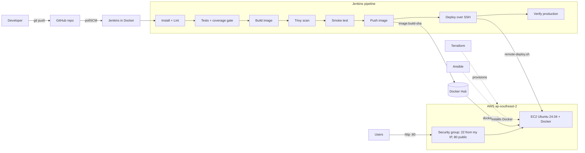

# DevOps Calculator: End-to-End CI/CD on AWS
 
A simple calculator web app that I use to practice a full DevOps workflow. Every push to `main` is linted, tested, built into a Docker image, scanned for vulnerabilities, pushed to Docker Hub, and deployed to an AWS EC2 server. The server is created with Terraform and configured with Ansible.
 
The app is deliberately simple. The pipeline and the infrastructure are the point of the project.
 


 
---
 
## Architecture
 

 
---
 
## Pipeline stages
 
| # | Stage | What it does | Fails the build when |
|---|---|---|---|
| 1 | Info | Prints the commit, tool versions and the image tag (`<build>-<git sha>`) | - |
| 2 | Install | `npm ci` from the lock file (reproducible, uses the npm cache) | Dependencies cannot be installed |
| 3 | Lint | ESLint | Any lint error |
| 4 | Test | Jest unit + API tests, JUnit report, coverage report | A test fails or line coverage < 80% |
| 5 | Build Image | Multi-stage Docker build with the version baked in | The Dockerfile fails |
| 6 | Security Scan | Trivy reports HIGH + CRITICAL issues | A fixable CRITICAL vulnerability is found |
| 7 | Smoke Test | Runs the image and checks `/health` returns this exact version | The container does not start or serve the right version |
| 8 | Push | Pushes `<build>-<sha>` and `latest` to Docker Hub | Docker Hub rejects the push |
| 9 | Deploy to AWS | SSHes to EC2 and runs `scripts/remote-deploy.sh` | Pull fails or the new container is unhealthy |
| 10 | Verify Production | Calls `http://<server>/health` from outside, like a real user | Production is not serving the new version |
 
Cheap checks run first and slow ones last, so a broken commit fails within seconds and never produces an image.
 
---
 
## Tech stack
 
| Area | Tools |
|---|---|
| Application | Node.js 22, Express, vanilla HTML/JS |
| Testing & quality | Jest, Supertest, jest-junit, ESLint |
| Containers | Docker (multi-stage, Alpine, non-root), Docker Compose |
| CI/CD | Jenkins (Declarative Pipeline, running in Docker) |
| Security | Trivy image scanning, Jenkins credentials, Docker Hub access tokens |
| Registry | Docker Hub |
| Infrastructure as Code | Terraform (AWS provider) |
| Configuration management | Ansible |
| Cloud | AWS EC2, Security Groups, IAM |
 
---
 
## Repository structure
 
```
calculator-devops/
├── src/                     # Express app (logic, routes, server)
├── public/                  # Web UI
├── tests/                   # Unit and API tests
├── scripts/
│   └── remote-deploy.sh     # Runs on the EC2 server during deploy
├── infra/
│   ├── jenkins/             # Custom Jenkins image (Node + Docker CLI + plugins) and compose file
│   ├── terraform/           # EC2, security group, key pair
│   └── ansible/             # Server setup playbook (Docker install)
├── Dockerfile               # Production image
├── docker-compose.yml       # Run the app locally
├── Jenkinsfile              # CI/CD pipeline
└── .gitattributes           # Forces LF line endings for scripts
```
 
---
 
## Security practices
 
- **Non-root container.** The app runs as the `node` user, not root.
- **Smaller attack surface.** npm, yarn and corepack are removed from the runtime image because the app never uses them.
- **Vulnerability gate.** Trivy blocks images with fixable CRITICAL vulnerabilities before they reach the registry.
- **No secrets in Git.** The Docker Hub token and SSH key live in Jenkins credentials and are masked in logs. `terraform.tfvars`, state files and inventories are git-ignored.
- **Docker Hub access token** with limited scope instead of the account password.
- **SSH only from my IP.** The security group opens port 22 to a single `/32` address and only port 80 to the internet.
- **Hardened EC2.** Encrypted root volume and IMDSv2 required.
- **Host key checking kept on.** SSH uses `StrictHostKeyChecking=accept-new` instead of disabling it.
- **Safe deploys.** The deploy script pulls the new image before removing the old container, so a failed pull leaves the old version running.
 
---
 
## Run it yourself
 
### 1. Locally
 
```bash
npm ci
npm run lint
npm test
npm start                 # http://localhost:3000
```
 
### 2. With Docker
 
```bash
docker compose up -d --build
curl http://localhost:3000/health
```
 
### 3. Jenkins
 
```bash
cd infra/jenkins
export DOCKER_GID=$(stat -c '%g' /var/run/docker.sock)
docker compose up -d --build   # http://localhost:8080
```
 
Then in Jenkins:
 
1. Add credentials `dockerhub-creds` (username + access token) and `ec2-ssh-key` (SSH private key, user `ubuntu`).
2. Add a global environment variable `DEPLOY_HOST` with the server IP.
3. Create a Pipeline job: **Pipeline script from SCM**, this repo, branch `*/main`, script path `Jenkinsfile`.
4. Set `DOCKERHUB_REPO` in the `Jenkinsfile` to your own Docker Hub repo.
 
### 4. AWS infrastructure
 
```bash
cd infra/terraform
cp terraform.tfvars.example terraform.tfvars   # set my_ip and aws_region
terraform init
terraform plan
terraform apply
```
 
### 5. Server configuration
 
```bash
cd infra/ansible
echo "[app]
$(terraform -chdir=../terraform output -raw public_ip)" > inventory.ini
export ANSIBLE_CONFIG="$PWD/ansible.cfg"
ansible app -m ping
ansible-playbook setup-server.yml
```
 
Push a commit and Jenkins deploys it to `http://<server-ip>`.
 
### Clean up
 
```bash
terraform -chdir=infra/terraform destroy
```
 
---
 
## Rollback
 
Every image is tagged `<build number>-<git sha>` and kept in Docker Hub, so rolling back means redeploying an older tag:
 
```bash
ssh -i ~/.ssh/calculator-devops ubuntu@<server-ip> \
    "bash -s" -- "<dockerhub-user>/calculator-devops:<old-tag>" "<old-tag>" \
    < scripts/remote-deploy.sh
```
 
The git SHA inside the tag points straight to the commit that is running in production. After a rollback, the bad commit is undone with `git revert <sha>` so the next pipeline run deploys fixed code.
 
---
 
## Problems I ran into and how I solved them
 
| Problem | Cause | Fix |
|---|---|---|
| `npm` and `docker pull` failed with DNS timeouts | WSL's generated `resolv.conf` stopped answering | Set fixed DNS servers in `/etc/resolv.conf` and turned off `generateResolvConf` |
| Docker daemon stopped starting | Overwriting `/etc/wsl.conf` removed `systemd=true` | Restored the `[boot]` section. Lesson: append to config files, do not overwrite them |
| Jenkins could not bind port 8080 | An old Jenkins service was already running in WSL | Found it with `ss -ltnp`, then `systemctl stop` and `disable` |
| `terraform plan` failed with `UnauthorizedOperation` | An AWS Organizations SCP only allows one region | Read the explicit-deny error and set `aws_region` to the allowed region |
| Ansible ignored `ansible.cfg` | `/mnt/c` folders are world-writable, so Ansible skips them for security | Pointed `ANSIBLE_CONFIG` at the file explicitly |
| A bug reached a build | Pipeline worked as designed | The Test stage went red and no image was built or deployed |
| Build cache grew to several GB | Docker never prunes build cache on its own | Added `docker builder prune --filter until=72h` to the pipeline |
 
---
 
 
## What I would improve next
 
- Run Jenkins on its own server and trigger builds with a **GitHub webhook** instead of polling.
- Add a parameterized **rollback job** in Jenkins so anyone on the team can roll back from the UI.
- Use a dedicated **deploy user and key**, or AWS **SSM Session Manager** with no SSH keys at all.
- Serve the app over **HTTPS** with a domain name (Nginx + Let's Encrypt).
- Store Terraform state remotely in **S3** with locking.
- Add **monitoring** (Prometheus + Grafana or CloudWatch).
- Use **blue-green deployment** for zero downtime.
 
---
 
## Author
 
**Dulanga Lakshan**
 
[LinkedIn](www.linkedin.com/in/dulanga-lakshan-97907a26b) · [GitHub](https://github.com/dualangalakshan002)
 